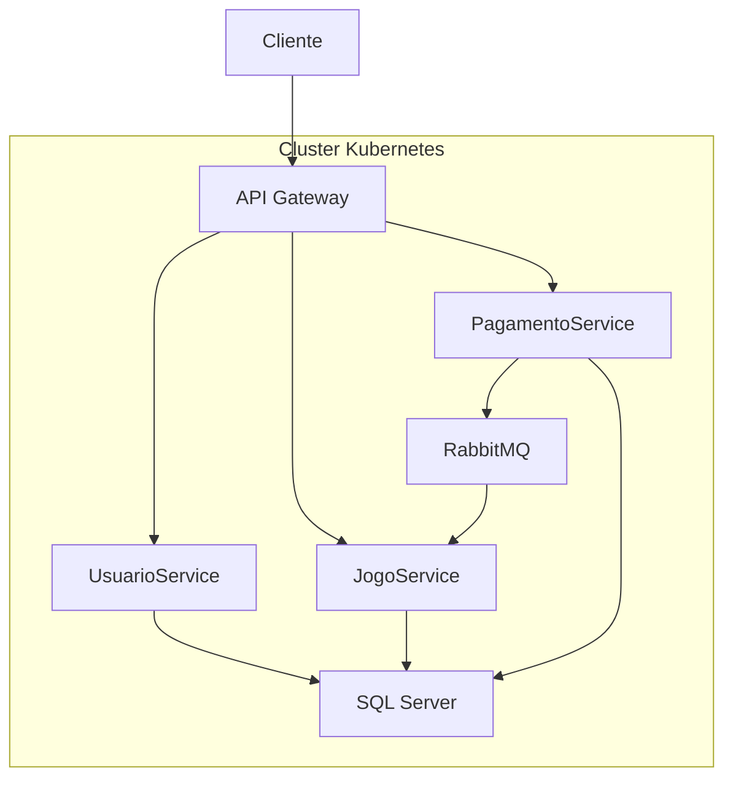
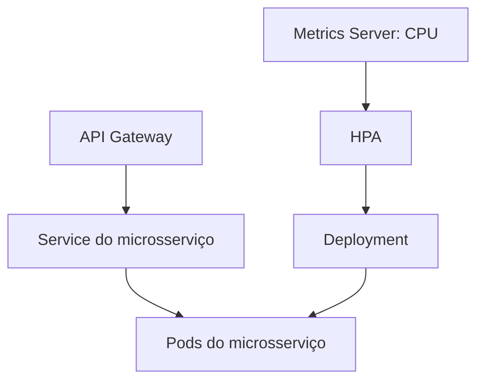
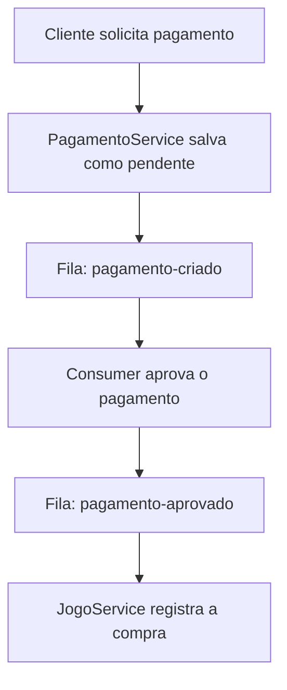

# 🎮 FIAP Cloud Games (FCG)

Projeto acadêmico de backend para uma plataforma de jogos digitais, desenvolvido na pós-graduação em Arquitetura de Sistemas .NET com Azure da FIAP. A aplicação utiliza microsserviços para gerenciar usuários, jogos e pagamentos, com comunicação assíncrona via RabbitMQ e orquestração com Kubernetes.

## 🏗️ Arquitetura

- **UsuarioService (`FGC/`)**: usuários, perfis e autenticação com JWT.
- **JogoService**: catálogo, avaliações e registro de compras.
- **PagamentoService**: cadastro e processamento de pagamentos.
- **API Gateway**: entrada para as APIs e roteamento com YARP.
- **SQL Server**: persistência dos dados em bancos separados por serviço.
- **RabbitMQ**: comunicação por mensagens entre as etapas de pagamento e compra.

### Visão da implantação no Kubernetes



Os manifestos definem Deployments, Services, ConfigMap, Secret, armazenamento persistente e HPA. A execução em Kubernetes foi testada localmente com Docker Desktop; uma implantação em nuvem deve ser configurada e validada separadamente.

### Como o Kubernetes organiza os serviços

O diagrama abaixo mostra a estrutura usada para cada microsserviço. UsuarioService, JogoService e PagamentoService possuem seus próprios Deployments, Services e HPAs.



- **Namespace `fcg`:** agrupa os recursos da aplicação no cluster.
- **Deployment:** define como executar cada aplicação e gerencia suas réplicas.
- **Pod:** unidade que executa o contêiner da aplicação.
- **Service:** fornece um endereço para acessar os pods, mesmo quando eles mudam.
- **HPA:** ajusta as réplicas dos três microsserviços. Os manifestos definem de 1 a 5 réplicas e uma meta média de CPU de 60%.
- **Metrics Server:** disponibiliza métricas de recursos usadas pelo HPA.
- **ConfigMap e Secret:** fornecem configurações e dados sensíveis aos serviços.
- **PersistentVolumeClaim (PVC):** solicita armazenamento persistente para os dados do SQL Server.
- **Health checks:** ajudam o Kubernetes a identificar se as aplicações estão prontas e saudáveis.

O API Gateway também tem Deployment e Service próprios. Para acesso local ao Gateway, este README usa `port-forward`; os manifestos não demonstram, por si só, uma implantação em nuvem.

## 🔄 Fluxo de pagamento



1. O PagamentoService grava o pagamento com status **Pendente** e publica o evento `pagamento-criado`.
2. Seu consumer processa o evento, altera o status para **Aprovado** e publica `pagamento-aprovado`. A aprovação é uma simulação, sem integração com um provedor de pagamento.
3. O JogoService consome a aprovação, registra a compra e incrementa o número de vendas do jogo. O serviço verifica o identificador do pagamento para evitar o registro duplicado da compra.

As filas desacoplam o processamento: cada consumer recebe a mensagem e executa sua etapa. O JogoService possui tratamento para mensagens inválidas, reenvio em algumas falhas e uma fila de falhas para jogo não encontrado.

## 🛠️ Tecnologias

- C# e .NET 8
- ASP.NET Core Web API
- Entity Framework Core
- SQL Server
- JWT
- RabbitMQ
- YARP
- Docker e Docker Compose
- Kubernetes
- OpenTelemetry
- Prometheus
- Grafana
- Tempo
- Loki

## 📂 Estrutura principal

| Pasta ou arquivo | Conteúdo |
| --- | --- |
| `FGC/` | UsuarioService |
| `JogoService/` | API de jogos e consumer de pagamentos aprovados |
| `PagamentoService/` | API e processamento de pagamentos |
| `ApiGateway/` | Gateway e configuração do YARP |
| `kubernetes/` | Manifestos de implantação, configuração e HPA |
| `observabilidade/` | Configuração do Collector, Prometheus, Grafana, Tempo e Loki |
| `docker-compose.yml` | Serviços da aplicação para execução local |
| `FGC.sln` | Solução .NET |

## 🐳 Execução local com Docker Compose

### Pré-requisitos

- Docker Desktop com Docker Compose.
- Portas 8081 a 8084 e 15672 disponíveis.
- Para observabilidade, portas 3000, 3100, 3200, 4317, 4318 e 9090 disponíveis.
- Senhas locais para o SQL Server e RabbitMQ.
- A mesma chave JWT, issuer e audience configurados nos serviços de usuário, jogo e pagamento.

Use configurações locais ou variáveis de ambiente e não publique segredos no repositório.

### 1. Configurar as variáveis de ambiente

Na raiz do projeto, crie um arquivo `.env` local para as variáveis usadas pelo Compose, substituindo os valores por senhas próprias:

```dotenv
SQL_SA_PASSWORD=sua_senha_forte_do_sql
RABBITMQ_PASSWORD=sua_senha_do_rabbitmq
```

A senha do SQL Server deve cumprir a política de complexidade da imagem.

### 2. Criar a rede e o volume

A rede e o volume do SQL Server são externos ao Compose. Caso ainda não existam, crie-os uma vez:

```powershell
docker network create fcg-network
docker volume create fcg-sqlserver-data
```

Se já existirem, não é necessário recriá-los.

### 3. Iniciar os serviços

Na raiz do projeto, execute:

```powershell
docker compose up -d --build
docker compose ps
```

As migrações do Entity Framework estão configuradas para serem aplicadas na inicialização dos serviços. Aguarde o SQL Server e o RabbitMQ ficarem prontos.

Para acompanhar erros de inicialização:

```powershell
docker compose logs --tail=100
```

### Endereços locais

| Componente | Endereço |
| --- | --- |
| API Gateway | http://localhost:8082 |
| UsuarioService / Swagger | http://localhost:8081/swagger |
| JogoService / Swagger | http://localhost:8083/swagger |
| PagamentoService / Swagger | http://localhost:8084/swagger |
| Painel RabbitMQ | http://localhost:15672 |

O usuário do RabbitMQ no Compose é `fcg`; a senha é a definida em `RABBITMQ_PASSWORD`.

O Gateway encaminha as rotas com os prefixos `/usuarios`, `/jogos` e `/pagamentos`. Para endpoints protegidos, crie os dados necessários, faça login e use o token JWT retornado.

### Parar os serviços

```powershell
docker compose down
```

## 📊 Observabilidade

Os serviços usam OpenTelemetry para coletar traces, métricas e logs. O Collector recebe os dados e os encaminha para Tempo, Prometheus e Loki; o Grafana permite consultá-los e criar painéis.

Para iniciar a infraestrutura de observabilidade depois de criar a rede `fcg-network`:

```powershell
docker compose -f .\observabilidade\docker-compose.yml up -d
docker compose -f .\observabilidade\docker-compose.yml ps
```

Acesse:

- **Grafana:** http://localhost:3000
- **Prometheus:** http://localhost:9090

O arquivo `observabilidade/fcg-dashboard.json` pode ser importado no Grafana.

As métricas de status HTTP, tempo de resposta e requisições por segundo ajudam a acompanhar o comportamento da aplicação. Os traces mostram o caminho e a duração das operações entre serviços.

Para parar os componentes de observabilidade:

```powershell
docker compose -f .\observabilidade\docker-compose.yml down
```

## ☸️ Kubernetes

Os arquivos em `kubernetes/` permitem uma implantação local.

É necessário:

1. Habilitar o Kubernetes no Docker Desktop.
2. Ter o `kubectl` configurado.
3. Construir as imagens locais.
4. Preparar um Secret real a partir de `kubernetes/secret.example.yaml`, com senhas, JWT e as três connection strings apropriadas.

**Não envie o arquivo com os valores reais ao Git.**

Aplique o namespace, o ConfigMap e seu Secret local, seguidos dos manifestos dos serviços e do HPA. O HPA precisa de métricas de recursos disponíveis no cluster, por exemplo por meio do Metrics Server.

Consulte o estado dos recursos:

```powershell
kubectl get pods,services,hpa -n fcg
kubectl top pods -n fcg
```

O Gateway pode ser acessado localmente por port-forward:

```powershell
kubectl port-forward -n fcg svc/apigateway 8090:80
```

Em outro terminal, acesse:

```text
http://localhost:8090/health
```

Para interromper o port-forward, pressione `Ctrl+C` no terminal onde ele está executando.

A configuração de imagens, armazenamento e acesso deve ser adaptada para um provedor de nuvem.

## ✅ Validações realizadas

Durante o desenvolvimento foram testados:

- Autenticação JWT e rotas pelo API Gateway.
- Criação e consulta de pagamentos.
- Publicação e consumo de mensagens.
- Funcionamento dos pods no Kubernetes.
- Escalonamento do JogoService pelo HPA.
- Visualização de traces no OpenTelemetry Collector.
- Criação de um dashboard no Grafana.

Os resultados dependem da configuração e dos dados de cada ambiente.

## 👨‍💻 Autor

**Gabriel Aljarila dos Santos**

Projeto acadêmico e de aprendizado.
